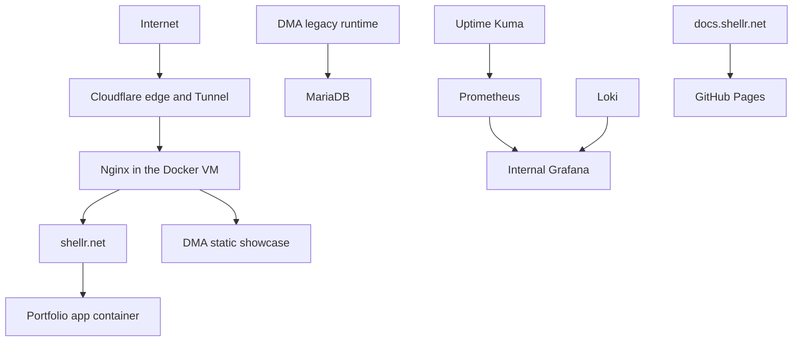

# shellr / genesis

Single-VM DevOps portfolio platform for [shellr.net](https://shellr.net).

Genesis runs in a Docker VM on operator-owned Proxmox VE hardware in Germany. It includes the public portfolio, a DMA workload, internal monitoring and logging, and backup and recovery tooling.

## Live Surfaces

- `https://shellr.net` - personal landing page and platform frontdoor
- `https://dma.shellr.net` - read-only DMA project showcase
- `https://docs.shellr.net` - technical documentation on GitHub Pages

## Architecture Overview



## Technical Focus

- Docker Compose runtime on a Proxmox VE VM
- Cloudflare Tunnel and HTTPS to the Nginx origin
- PHP application workloads with MariaDB
- CI-built and scanned registry images, immutable-digest pull deployment, health checks, and rollback
- Internal metrics, logs and dashboard state; Uptime Kuma remains during the comparison period
- Logging through Loki and Grafana Alloy
- Daily database and SQLite backups with encrypted offsite Restic snapshots

## Repository Layout

```text
/projects/genesis
  app/                  shellr.net landing page
  dma/                  DMA application
  infra/
    compose/            main runtime stack
    nginx/              reverse proxy and TLS config
    monitoring/         Prometheus, Grafana, Kuma, cAdvisor
    logging/            Loki and Grafana Alloy
    backup/             backup artifacts and cron definitions
  scripts/              deploy, backup, restore, and helper scripts
  docs/                 technical documentation and GitHub Pages source
```

## Operating model

Production follows the [verified release flow](docs/deployment-flow.md): CI builds and scans the application images once, publishes immutable registry digests, and the host pulls those exact images. The deployment receipt changes only after running-image, routing, health and header verification. An explicit emergency host-build path remains documented; it is never an automatic fallback.

Initial provisioning requires operator-managed environment files, persistent storage, certificate state and private credentials. The aggregate-status bind directory must exist before bootstrapping the stack. Those private files and host mappings are not supplied by the public repository. Host integration in the deploy script remains disabled: normal deployment does not install or enable cron jobs, timers or certificate tooling. Existing backup schedules and certificate renewal remain separately managed.

No alert delivery or external notifying monitor is configured. Host, power or Internet failure can also make the internal dashboard unavailable; detection depends on the next operator check. Local and offsite backup evidence is evaluated independently.

## Documentation

- [Docs Index](/docs/README.md)
- [Projects](/docs/projects.md)
- [Architecture](/docs/architecture.md)
- [Deployment Flow](/docs/deployment-flow.md)
- [Monitoring](/docs/monitoring.md)
- [Logging](/docs/logging.md)
- [Routing and DNS](/docs/routing-dns.md)
- [Backup and Restore](/docs/backup-restore.md)
- [Weekly System Maintenance](/docs/maintenance.md)
- [Lessons Learned](/docs/lessons-learned.md)
- [GitHub Pages](/docs/github-pages.md)

## Operational Notes

- `docs.shellr.net` is intentionally hosted on GitHub Pages, not on the VM
- the platform is designed for maintainability and explainability over tool sprawl
