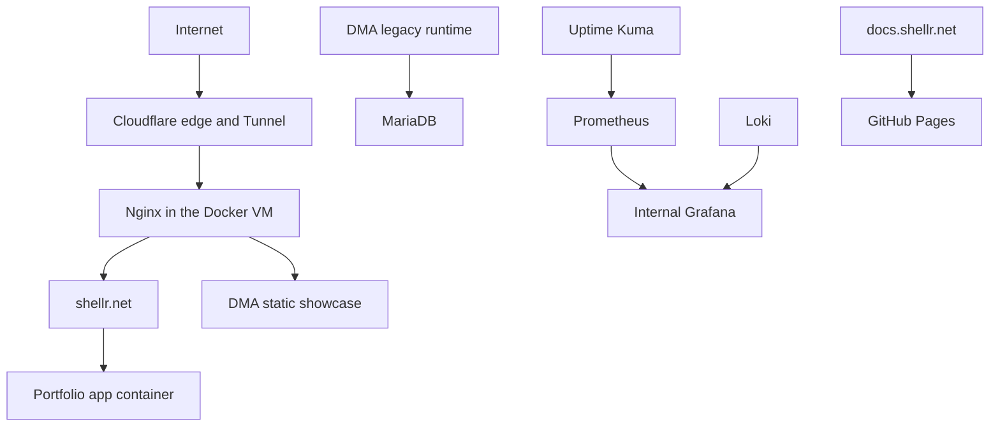

# shellr / genesis

Single-VM DevOps portfolio platform for [shellr.net](https://shellr.net).

Genesis runs in a Docker VM on operator-owned Proxmox VE hardware in Germany. It includes the public portfolio, a DMA workload, internal monitoring and logging, and backup and recovery tooling.

## Live Surfaces

- `https://shellr.net` - personal landing page and platform frontdoor
- `https://dma.shellr.net` - read-only DMA project showcase
- `https://docs.shellr.net` - technical documentation on GitHub Pages

## Architecture Overview



## Technical Focus

- Docker Compose runtime on a Proxmox VE VM
- Cloudflare Tunnel and HTTPS to the Nginx origin
- PHP application workloads with MariaDB
- GitHub Actions release publishing with host-initiated pull, health checks, and rollback
- Monitoring through Prometheus, Grafana, Node Exporter, cAdvisor, and Uptime Kuma
- Logging through Loki and Grafana Alloy
- Daily database and SQLite backups with encrypted offsite Restic snapshots

## Repository Layout

```text
/projects/genesis
  app/                  shellr.net landing page
  dma/                  DMA application
  infra/
    compose/            main runtime stack
    nginx/              reverse proxy and TLS config
    monitoring/         Prometheus, Grafana, Kuma, cAdvisor
    logging/            Loki and Grafana Alloy
    analytics/          AWStats reference configuration and report generator
    backup/             backup artifacts and cron definitions
  scripts/              deploy, backup, restore, and helper scripts
  docs/                 technical documentation and GitHub Pages source
```

## Getting Started

### 1. Create the required Docker networks

```bash
docker network create genesis_frontend || true
docker network create genesis_backend || true
docker network create genesis_monitoring || true
```

### 2. Prepare environment files

```bash
cp infra/compose/.env.example infra/compose/.env
cp infra/monitoring/.env.example infra/monitoring/.env
cp infra/logging/.env.example infra/logging/.env
```

Fill in real secrets before starting the platform.

### 3. Start the main platform

```bash
docker compose \
  --env-file infra/compose/.env \
  -f infra/compose/docker-compose.yml \
  up -d --build
```

### 4. Start monitoring

```bash
docker compose \
  --env-file infra/monitoring/.env \
  -f infra/monitoring/docker-compose.monitoring.yml \
  up -d
```

### 5. Start logging

```bash
docker compose \
  --env-file infra/logging/.env \
  -f infra/logging/docker-compose.logging.yml \
  up -d
```

## Documentation

- [Docs Index](/docs/README.md)
- [Projects](/docs/projects.md)
- [Architecture](/docs/architecture.md)
- [Deployment Flow](/docs/deployment-flow.md)
- [Monitoring](/docs/monitoring.md)
- [Logging](/docs/logging.md)
- [Routing and DNS](/docs/routing-dns.md)
- [Backup and Restore](/docs/backup-restore.md)
- [Weekly System Maintenance](/docs/maintenance.md)
- [Lessons Learned](/docs/lessons-learned.md)
- [GitHub Pages](/docs/github-pages.md)

## Operational Notes

- `docs.shellr.net` is intentionally hosted on GitHub Pages, not on the VM
- the platform is designed for maintainability and explainability over tool sprawl
